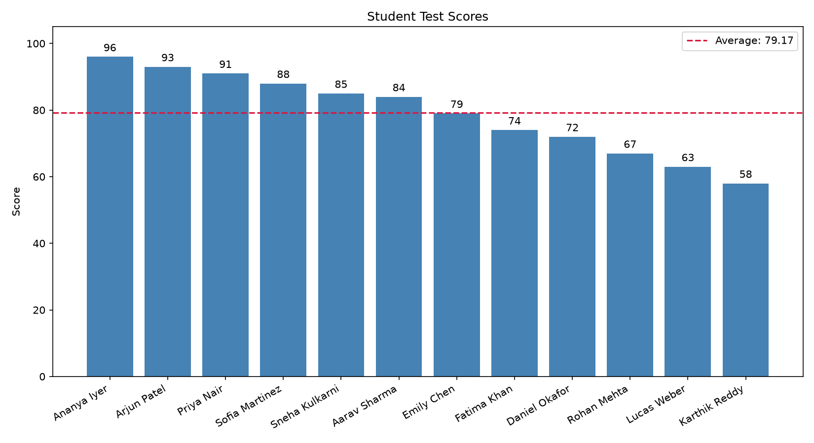

# accuknox-assignment

Screening assignment for the AI Security Engineer Trainee role at AccuKnox.

## Contents

| Task | Where |
|---|---|
| Problem 1, Q1 (books API to SQLite) | [problem1_books_api/](problem1_books_api/) |
| Problem 1, Q2 (scores API and chart) | [problem2_student_scores/](problem2_student_scores/) |
| Problem 1, Q3 (CSV to SQLite) | [problem3_csv_to_sqlite/](problem3_csv_to_sqlite/) |
| Problem 1, Q4 and Q5 (code links) | [answers/problem1_code_links.md](answers/problem1_code_links.md) |
| Assignment 2 | [answers/assignment2_ai_questions.md](answers/assignment2_ai_questions.md) |
| Assignment 3 | [answers/assignment3_project.md](answers/assignment3_project.md) |

## Assumptions

- Book data comes from the Open Library Search API because it is free and needs no key.
- No scores API was given, so `mock_scores_api.py` serves 12 sample students locally.
- `users.csv` is made-up data with one duplicate, one bad email and one blank name.

## Setup and run

Python 3.10 or newer.

```bash
pip install -r requirements.txt

python problem1_books_api/fetch_books.py
python problem3_csv_to_sqlite/import_users.py
```

The chart script needs the mock API running in a second terminal.

```bash
python problem2_student_scores/mock_scores_api.py
python problem2_student_scores/scores_chart.py
```

Both database scripts are safe to re-run. Duplicates are skipped by `INSERT OR IGNORE`.


